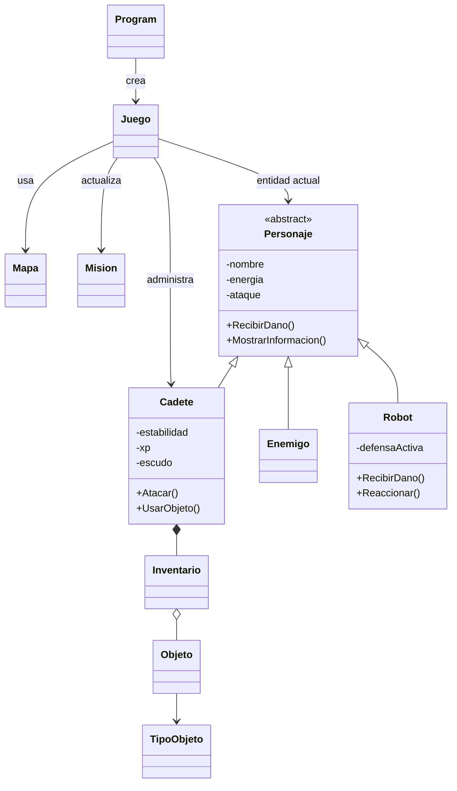
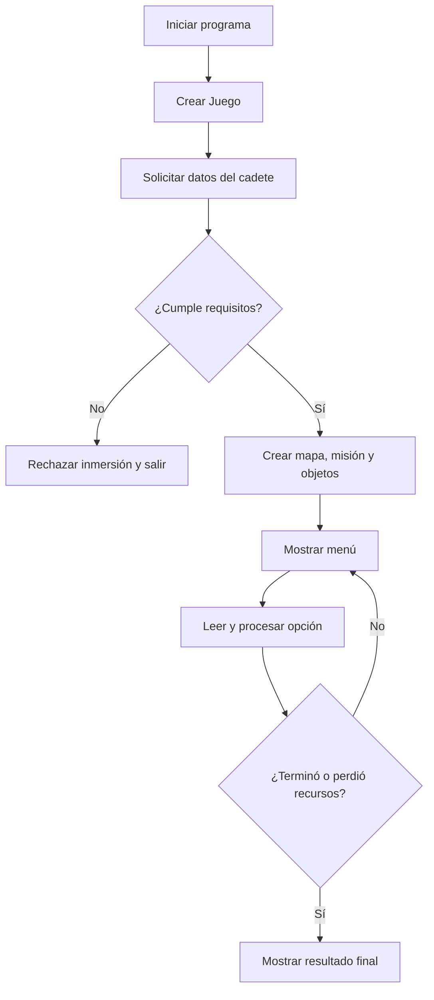

# NEXUS — Manual técnico y preparación para el examen H3

**Proyecto:** POO Nexus / NEXUS v2.0  
**Lenguaje:** C# · **Framework objetivo:** .NET 10 (net10.0)  
**Fuente principal:** POO Nexus/Program.cs  
**Autor:** Benji Pacheco Lafuente

> Las clases descritas están dentro de un único Program.cs. Los comentarios con nombres como Personaje.cs o Robot.cs son separadores lógicos, no archivos independientes. Interfaces y LINQ se explican como ejemplos complementarios porque no aparecen implementados en el código revisado.

## Cómo estudiar sin conexión

Descarga este manual y el repositorio antes de desconectarte. Lee una sección, localiza el método en Program.cs y explica el resultado con tus propias palabras. Ejecuta los ejemplos en una copia de trabajo, no directamente sobre la versión que entregarás.

## I. Arquitectura y programación orientada a objetos

### 1. Propósito y flujo general

NEXUS es un juego de exploración y supervivencia por consola ambientado en el año 2297. El jugador crea un cadete, explora una cuadrícula de 3 × 3, encuentra objetos y registros de IRIS, gestiona energía y estabilidad, combate entidades y debe completar cuatro objetivos antes de regresar a extracción.

Program.Main crea un objeto Juego y llama a Iniciar(). Juego solicita los datos del cadete; si los requisitos se cumplen, crea Mapa y Mision, entrega una célula de energía y un analizador, muestra el menú y procesa acciones hasta que la partida termina, el jugador pierde energía/estabilidad o completa la misión.

### 2. Responsabilidades de las clases

| Clase o tipo | Responsabilidad |
|---|---|
| Program | Punto de entrada; crea Juego e inicia la partida. |
| Juego | Coordina menú, movimiento, eventos aleatorios, combates y fin de partida. |
| Personaje | Clase abstracta base con nombre, energía, ataque y comportamientos comunes. |
| Cadete | Jugador; gestiona estabilidad, XP, escudo, inventario, pistas y exploración. |
| Enemigo | Entidad que contraataca y entrega 20 XP al ser derrotada. |
| Robot | Entidad con defensa que reduce a la mitad el daño y entrega 30 XP. |
| Objeto / TipoObjeto | Representa objetos y sus tipos: Celula, Escudo, ModuloAtaque y Analizador. |
| Inventario | Mantiene List<Objeto>, controla capacidad y agrega, consulta, busca y elimina objetos. |
| Mapa | Controla la cuadrícula, posición, movimiento y detección de extracción/anomalía. |
| Mision | Registra objetivos cumplidos y recompensa de experiencia. |

### 3. Diagrama de clases



La flecha de herencia parte de la clase derivada hacia la base. Juego coordina objetos; Cadete contiene un Inventario y este almacena objetos.

### 4. Programación estructurada y POO

La programación estructurada organiza el control en secuencias, decisiones, ciclos y procedimientos. La POO agrupa estado y comportamiento en objetos que colaboran. NEXUS combina ambas: la arquitectura se basa en clases, mientras que los métodos usan if, while, for y switch para controlar la ejecución. POO no elimina las estructuras de control.

## II. Fundamentos de clases y objetos

### 5. Clases, objetos e instanciación

Una clase describe datos y operaciones; un objeto es una instancia concreta creada con new. En Program.Main se instancia Juego. En Juego.Iniciar se crean Mapa y Mision; cuando los datos del usuario cumplen los requisitos se crea Cadete.

### 6. Campos, propiedades y métodos

Los campos nombre, energia y ataque de Personaje son privados. Métodos como GetEnergia(), PerderEnergia() y RecuperarEnergia() exponen operaciones controladas. C# también permite propiedades, por ejemplo public int Energia { get; private set; }, pero el código revisado usa principalmente campos privados y métodos de acceso.

### 7. Constructores, sobrecarga, this y base

Un constructor inicializa un objeto. Personaje(string nombre, int energia, int ataque) guarda sus parámetros. El constructor de Cadete usa base(nombre, energia, 10) para inicializar la parte heredada y this.estabilidad = estabilidad para distinguir el campo del parámetro.

Sobrecarga significa tener varios métodos o constructores con el mismo nombre y diferentes listas de parámetros. En el código revisado no se observa sobrecarga de constructores. Ejemplo complementario:

```csharp
class Registro
{
    public string Nombre { get; }
    public Registro(string nombre) => Nombre = nombre;
    public Registro(string nombre, int codigo) => Nombre = nombre + " #" + codigo;
}
```

this se refiere a la instancia actual. base(...) llama al constructor base; base.RecibirDano(dano) invoca la implementación de Personaje desde una clase derivada.

### 8. Encapsulamiento y modificadores

PerderEnergia evita energía negativa; RecuperarEnergia limita el máximo a 100. Centralizar estas reglas protege el estado.

- private: accesible dentro del tipo que lo declara.
- public: accesible desde otros tipos que puedan ver el miembro.
- protected: accesible desde la clase y sus derivadas.
- internal: accesible dentro del mismo ensamblado.

Program se declara internal. Las clases sin modificador de acceso explícito también tienen acceso internal por defecto.

## III. Herencia, polimorfismo e interfaces

### 9. Herencia y especialización

Cadete, Enemigo y Robot heredan de Personaje. Comparten nombre, energía, ataque y operaciones generales, pero añaden sus propias reglas: Cadete administra inventario y escudo; Enemigo contraataca y da 20 XP; Robot activa defensa y da 30 XP.

### 10. virtual, override y polimorfismo

Personaje declara métodos virtuales como RecibirDano(), AlAparecer() y Reaccionar(). Las clases derivadas los sobrescriben con override. Juego guarda la entidad activa en una referencia Personaje; si el objeto real es Robot, una llamada a RecibirDano ejecuta Robot.RecibirDano. La selección de la implementación ocurre en tiempo de ejecución.

Cadete primero permite que el escudo absorba daño y después llama a base.RecibirDano si queda daño. Robot reduce el daño con división entera: daño 5 se convierte en 2, porque 5 / 2 en C# con enteros trunca la fracción.

### 11. Clases y métodos abstractos

Personaje es abstracta y declara MostrarInformacion() como abstracto, sin cuerpo. Las clases concretas derivadas deben implementar ese método. Esto establece una operación común cuyo detalle cambia según el tipo de personaje.

### 12. Interfaces y composición

**No hay interfaces declaradas en la versión actual de NEXUS.** Una interfaz define un contrato de comportamiento sin exigir herencia de una clase base común. Ejemplo complementario:

```csharp
interface IAnalizable
{
    string ObtenerInforme();
}

class Sensor : IAnalizable
{
    public string ObtenerInforme() => "Lectura del sensor";
}
```

La herencia modela especialización y reutilización; la composición significa que un objeto contiene o utiliza otros objetos; una interfaz define una capacidad o contrato. Una clase puede implementar varias interfaces, aunque solo puede heredar directamente de una clase base.

## IV. Colecciones y LINQ

### 13. List<T> en NEXUS

Inventario declara List<Objeto> objetos e inicializa la lista vacía. Agregar() comprueba que Count no haya alcanzado capacidad antes de llamar a Add(). Consultar() recorre con for. Obtener(numero) y Eliminar(numero) reciben una posición visible que comienza en 1 y la convierten a índice restando 1, ya que las listas empiezan en índice 0.

```csharp
for (int i = 0; i < objetos.Count; i++)
{
    Console.WriteLine(objetos[i].GetDescripcion());
}
```

### 14. LINQ y expresiones lambda (ejemplo complementario)

El Program.cs revisado no contiene consultas LINQ ni expresiones lambda. Este ejemplo es adicional para estudiar el temario, no una función ya implementada en NEXUS.

```csharp
var descripciones = objetos
    .Where(o => o.GetValor() >= 20)
    .OrderBy(o => o.GetValor())
    .Select(o => o.GetDescripcion());

foreach (string descripcion in descripciones)
    Console.WriteLine(descripcion);
```

Where filtra elementos; OrderBy ordena; Select transforma cada elemento; o => ... es una expresión lambda. En este ejemplo se obtienen descripciones de objetos cuyo valor es al menos 20, ordenadas de menor a mayor valor. Un recorrido tradicional con foreach e if también puede hacer el filtrado, mientras que LINQ permite expresar transformaciones de forma declarativa.

## V. Análisis del funcionamiento

### 15. Flujograma del ciclo principal



### 16. Seguimiento del estado de un objeto

Supongamos que el cadete tiene 60 de energía y usa una célula de valor 25. UsarObjeto() llama a RecuperarEnergia(25) y luego elimina el objeto del inventario si el uso fue válido.

| Paso | Acción | Energía | Inventario |
|---|---|---:|---|
| 1 | Estado inicial supuesto | 60 | Célula disponible |
| 2 | RecuperarEnergia(25) | 85 | Célula disponible |
| 3 | Eliminar el objeto | 85 | Célula consumida |

Si la energía inicial fuera 90, el resultado sería 100, no 115, porque RecuperarEnergia limita el máximo.

### 17. Predicción de código

```csharp
Personaje entidad = new Robot("R-1", 30, 6);
entidad.AlAparecer();
entidad.RecibirDano(5);
Console.WriteLine(entidad.GetEnergia());
```

**Respuesta:** AlAparecer activa la defensa. El daño 5 se divide entre 2 con división entera y queda en 2. La energía pasa de 30 a 28, así que la última línea imprime 28. Antes se muestran mensajes sobre la defensa y el daño.

### 18. Efecto de modificar una condición

En Inventario.Agregar(), si la condición Count >= capacidad se cambia a Count > capacidad, el programa deja agregar un elemento cuando la lista ya alcanzó la capacidad. El inventario excedería el límite en una unidad. La condición >= es la correcta para rechazar una inserción cuando ya está lleno.

### 19. Observaciones técnicas verificables

- LeerEntero() comprueba que la entrada sea un entero, pero no todos los rangos semánticos; por ejemplo, no rechaza edades excesivamente altas.
- PerderEnergia() evita valores negativos y RecuperarEnergia() limita energía a 100.
- TerminarEncuentro() cumple el objetivo del encuentro con el guardián cuando termina el combate, incluso si el jugador escapó. Si la misión exige derrotarlo, la condición debería cambiar.
- Mapa.Mover() impide salir de la cuadrícula. Norte disminuye la fila y sur la aumenta.
- Las clases están en un solo Program.cs; separarlas en archivos sería una mejora de mantenimiento.
- No se encontraron interfaces ni LINQ en el archivo revisado.

## VI. Preguntas universitarias para el Hito 3

### 1. Comprensión de POO
**Pregunta:** ¿Por qué Juego puede mostrar el estado sin acceder a los campos privados de Cadete?  
**Respuesta:** llama a MostrarInformacion(), que pertenece a Cadete y accede a sus campos internos. Esto mantiene el encapsulamiento y evita acoplar Juego a los detalles internos del personaje.

### 2. Clases y objetos
**Pregunta:** ¿Qué crea new Inventario(8) y por qué otra clase no puede acceder a inventario.objetos?  
**Respuesta:** crea un Inventario con capacidad 8 y una lista vacía. objetos es privado y solo la clase Inventario puede acceder directamente; otras clases deben usar sus métodos públicos.

### 3. Herencia y polimorfismo
**Pregunta:** Una variable Personaje contiene un Robot. ¿Qué método recibe una llamada a RecibirDano()?  
**Respuesta:** Robot.RecibirDano(), porque el método virtual está sobrescrito y el objeto real determina la implementación en tiempo de ejecución.

### 4. Interfaces y diseño
**Pregunta:** ¿Qué ventaja tendría IAnalizable frente a una clase base Analizable?  
**Respuesta:** una interfaz permite que tipos de jerarquías distintas compartan un contrato sin tener que heredar de la misma clase. Es una propuesta complementaria; NEXUS no declara actualmente esa interfaz.

### 5. Listas y LINQ
**Pregunta:** ¿Cómo obtener descripciones de objetos de valor >= 20, ordenadas por valor?  
**Respuesta:** objetos.Where(o => o.GetValor() >= 20).OrderBy(o => o.GetValor()).Select(o => o.GetDescripcion()). Where filtra, OrderBy ordena y Select transforma. NEXUS actualmente recorre la lista con for y no usa LINQ.

### 6. Predicción y modificación
**Pregunta:** Un robot con 30 de energía y defensa activa recibe 7 de daño. ¿Qué energía conserva? ¿Qué pasa si no se activa la defensa?  
**Respuesta:** con defensa, 7 / 2 produce 3 y conserva 27. Sin defensa, recibe 7 y conserva 23. El resultado se debe a la sobrescritura de RecibirDano().

### Pregunta adicional: estado de misión
**Pregunta:** ¿Por qué Mision.EstaCompleta() recorre el arreglo cumplidos?  
**Respuesta:** porque cada objetivo tiene un estado independiente y la misión solo se completa cuando todos están cumplidos. Así también puede mostrarse qué objetivo falta.

## Diagnóstico del proceso de aprendizaje: Prompt espejo

### Alcance de la evidencia
Este diagnóstico se basa solo en la conversación disponible para preparar el repositorio. El estudiante pidió instrucciones paso a paso para GitHub Desktop, comunicó los estados observados y solicitó revisar Program.cs para documentar el comportamiento real. Las explicaciones técnicas de este manual fueron generadas por el asistente y no constituyen por sí mismas evidencia de dominio del estudiante.

### 1. Fortalezas demostradas
- Gestión progresiva del proyecto: siguió el proceso de publicación y preguntó al encontrar estados como “No local changes” y “Fetch origin”.
- Orientación a la documentación: pidió describir el código real en lugar de limitarse a una plantilla genérica.
- Seguimiento del proceso: comunicó lo que veía y confirmó que podía abrir el repositorio y consultar los archivos.
Estas evidencias muestran iniciativa y disposición a pedir ayuda. No demuestran por sí solas dominio de POO.

### 2. Falencias observadas
No hay respuestas técnicas propias del estudiante que expliquen constructores, encapsulamiento, herencia, polimorfismo, interfaces, colecciones o LINQ. No corresponde afirmar que haya cometido errores en esos temas, pero tampoco que los domine. Hace falta evidencia de explicaciones y ejercicios resueltos sin asistencia.

### 3. Diagnóstico del Hito 3

| Concepto | Clasificación | Justificación |
|---|---|---|
| POO | Evidencia insuficiente | No hay una explicación propia del paradigma. |
| Clases y objetos | Evidencia insuficiente | No explicó por cuenta propia instanciación y responsabilidades. |
| Constructores | Evidencia insuficiente | No razonó sobre inicialización ni sobrecarga. |
| Encapsulamiento | Evidencia insuficiente | No explicó campos privados y métodos de acceso. |
| Herencia | Evidencia insuficiente | No explicó la jerarquía Personaje y sus derivadas. |
| Polimorfismo | Evidencia insuficiente | No predijo por cuenta propia una llamada sobrescrita. |
| Interfaces | Evidencia insuficiente | No aportó explicación propia; el código no las implementa. |
| Listas genéricas | Evidencia insuficiente | No explicó List<Objeto> ni el control de capacidad. |
| LINQ y lambdas | Evidencia insuficiente | No resolvió un ejercicio y el código no las contiene. |
| Uso de herramientas | Comprensión parcial | Siguió instrucciones operativas y reportó resultados, pero no se midió independencia completa. |

### 4. Mi forma de aprender
La evidencia muestra un estilo guiado por pasos concretos: el estudiante ejecuta una acción, observa la interfaz y pregunta por el siguiente paso. Para el examen, conviene complementar ese método con práctica activa: predecir el resultado antes de ejecutar, justificarlo y luego comprobarlo.

### 5. Plan de estudio: cinco prioridades
1. **Encapsulamiento:** explica por qué PerderEnergia impide energía negativa. Ejercicio: predice qué pasa al perder 120 puntos desde 50.
2. **Herencia y constructores:** dibuja Personaje → Robot y explica base(nombre, energia, ataque). Ejercicio: diseña una entidad derivada de prueba.
3. **Polimorfismo:** sigue RecibirDano en un Robot. Ejercicio: predice daños 4, 5 y 7.
4. **Colecciones:** traza Agregar, Obtener y Eliminar con tres objetos. Ejercicio: explica la diferencia entre número mostrado e índice de lista.
5. **Interfaces y LINQ:** estudia los ejemplos complementarios. Ejercicio: filtra valores >= 20, ordénalos y explica cada operador.

### 6. Conclusión
La conversación demuestra progreso en publicación y documentación, así como iniciativa para pedir una revisión basada en el código real. No hay evidencia suficiente para certificar dominio independiente de los temas del Hito 3. Antes del examen, el estudiante debería poder dibujar la arquitectura, explicar constructores y encapsulamiento, predecir llamadas polimórficas, seguir el estado del inventario y escribir una consulta LINQ sencilla sin ayuda. Este diagnóstico separa el trabajo realizado con asistencia de los conocimientos que todavía deben demostrarse.

## Lista de verificación de entrega

- [ ] Confirmar que el repositorio es público.
- [ ] Compilar con el SDK de .NET 10.
- [ ] Revisar ejemplos contra el código.
- [ ] Exportar este manual a PDF y guardarlo en docs/.
- [ ] Conservar el Markdown como versión editable.
- [ ] Entregar en Moodle el enlace público, el PDF y el diagnóstico espejo.
